# Ist-Zustand Veilgrounds (2026-10-16)

Stand: Commit `bd34322` (live auf GitHub Pages). Screenshots aus dem gebauten Spiel bei 800×600 bzw. 1280×720.
Bewertung ehrlich gegen League of Legends. Offene Punkte stehen als Checkliste im Masterplan (docs/ROADMAP.md).

**Kurzfazit:** Alle Systeme eines MOBAs sind vorhanden und spielbar (5v5 gegen Bots, 26 Champions, Items, Jungle,
Trainer). Die Mechanik ist seit heute deutlich näher an LoL (Wind-ups, Kollision, Zielen mit Anzeige, Puffer).
Die größten Baustellen sind **Maßstab/Proportionen der Karte und der Camps**, **Bot-Verhalten** (Wegfindung, Farm,
Spieldauer) und **Feinschliff der Kampf-Optik** (Projektile, CC-Anzeige).

| Bereich | Stand | Note (1–5, 5 = LoL-Niveau) |
|---|---|---|
| Menüs & Lobby | fertig, stimmig | 4 |
| Champions (Optik) | 26 gemalte Sprites, 12 Nicht-Menschen, neue Animationen | 3,5 |
| Karte | Gouache-Stil, aber Proportionen wirken falsch | 2,5 |
| Jungle-Camps | Inhalt da, Optik zu klein/schwach | 2 |
| Kampf-Mechanik | Wind-ups, Kollision, Puffer, Zielanzeige neu | 3,5 |
| Kampf-Lesbarkeit | HP-Nachlauf, Turmkreis, Funken; CC-Anzeige fehlt | 3 |
| Shop | neu im LoL-Stil | 4 |
| Bots | spielen alles, aber zu passiv, farmen schwach, pathen unsauber | 2,5 |
| Spieltempo | Partien 40–45 min statt ~30 | 2 |
| Trainer & Sandbox | 6 Trainer, Post-Game | 4 |

---

## 1. Hauptmenü
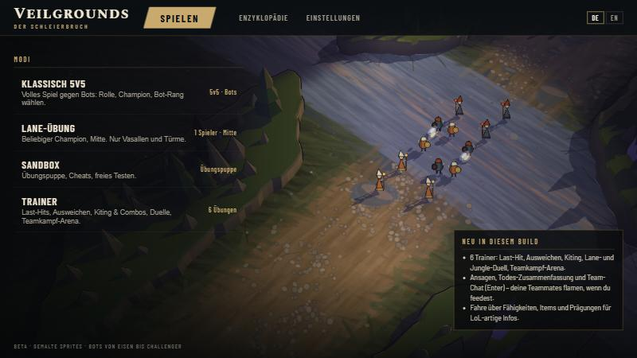

- **Gut:** klare Moduswahl, Neuigkeiten-Box, 3D-Hintergrund aus dem echten Spiel mit gemalten Minions.
- **Schwach:** Hintergrund ist beim ersten Frame dunkel (Minions laden 1,2 s später). Kein Profil, keine Statistik.

## 2. Lobby / Champion-Auswahl
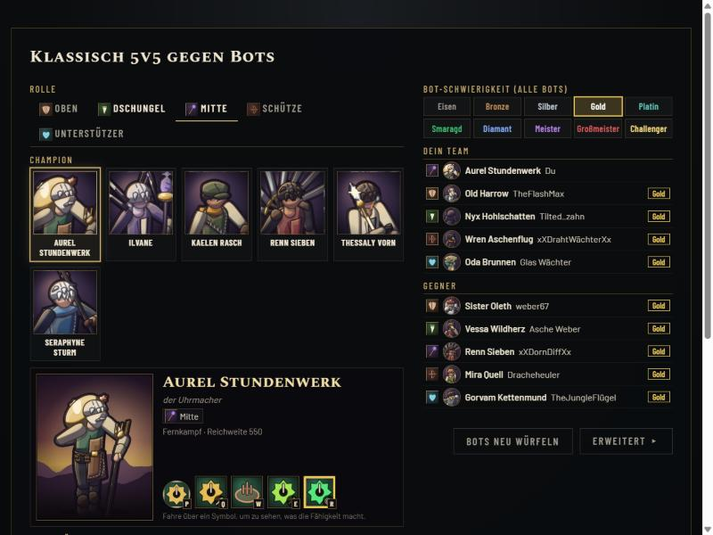

- **Gut:** Rollen-Tabs mit Icons, quadratische Porträt-Kacheln, großes Splash-Bild, Fähigkeits-Icons mit
  LoL-Tooltips, eine Bot-Schwierigkeit für alle Bots (Eisen–Challenger), Einzelwerte unter „Erweitert“.
- **Schwach:** Porträt-Ausschnitte teils ungünstig (Kopf angeschnitten, z. B. Ilvane/Seraphyne). Fähigkeits-Icons
  pro Champion sehr ähnlich (gleiches Motiv in mehreren Farben, z. B. Aurel nur Zahnräder).

## 3. Tooltips
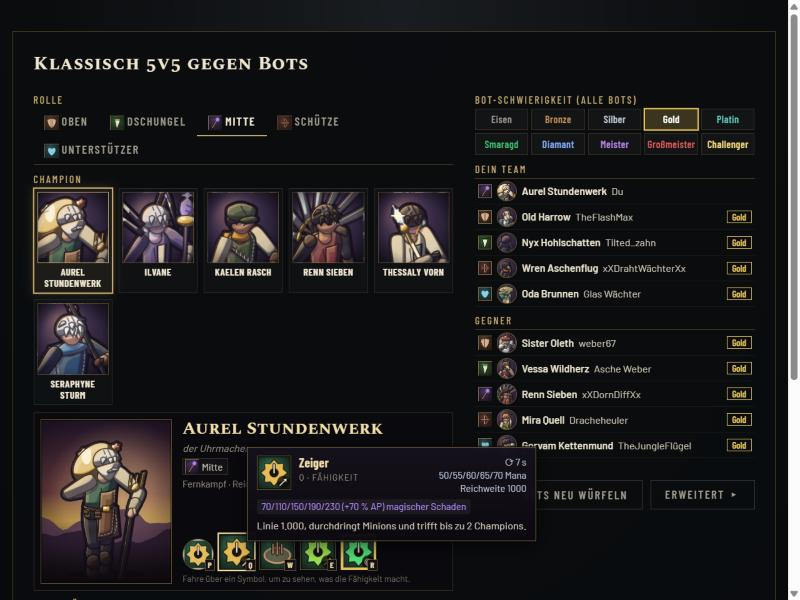

- **Gut:** LoL-artig: Name, Taste, Abklingzeit pro Rang, Kosten, Reichweite, Schaden mit farbiger Skalierung.
- **Schwach:** Beschreibungstexte der Daten sind kurz und technisch („Linie 1.000, durchdringt …“).

## 4. Ladebildschirm
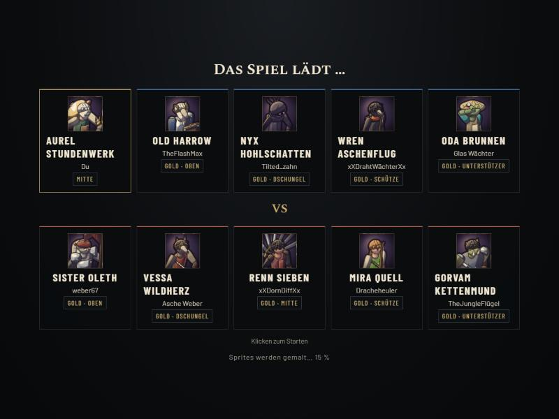

- **Gut:** alle 10 Spieler mit Porträt, Bot-Name, Rang, Rolle; Fortschritt „Sprites werden gemalt“.
- **Schwach:** Laden dauert spürbar (Champion-Atlas ~10–12 s bei Last). Keine Tipps/Lore während des Ladens.

## 5. Basis / Brunnen
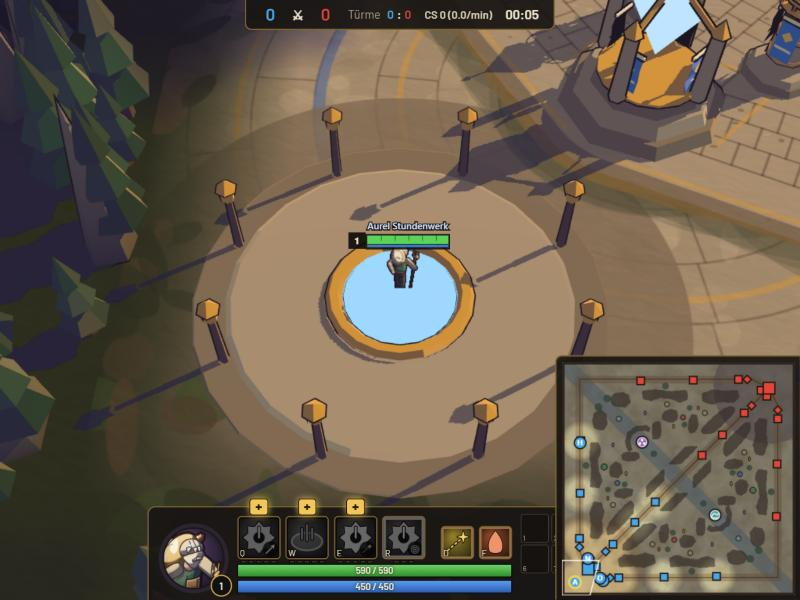

- **Gut:** gepflasterte Basis, Brunnen, Messing-Türme mit Bannern, Waldrand statt leerer Fläche.
- **Schwach:** Brunnenplatz wirkt leer und groß im Verhältnis zum Champion; Champion wirkt klein. Fähigkeits-Icons
  in der Leiste ausgegraut bis gelernt (korrekt), aber kaum unterscheidbar.

## 6. Lane / Wellenkampf
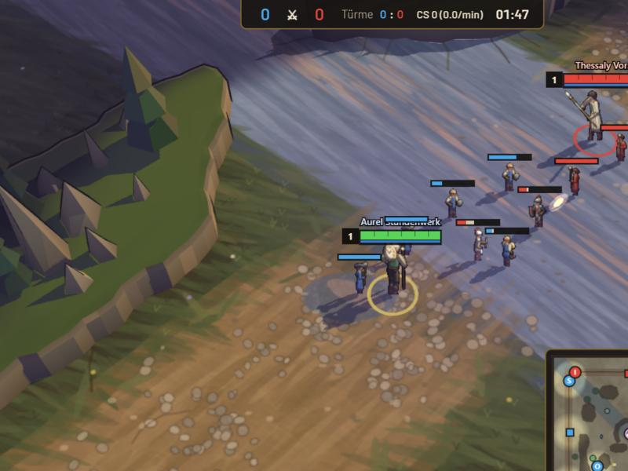

- **Gut:** gemalter Erdweg, Minions mit HP-Balken (jetzt immer sichtbar), Kampf läuft, Champions-Kollision neu.
- **Schwach:** Minions sehr klein im Verhältnis zur Lane-Breite; Projektile sind noch einheitliche Kleckse;
  viele HP-Balken überlagern sich. Der Lane-Weg ist sehr breit, Klippen sehr hoch → „abgecrackte“ Proportionen.

## 7. Turm
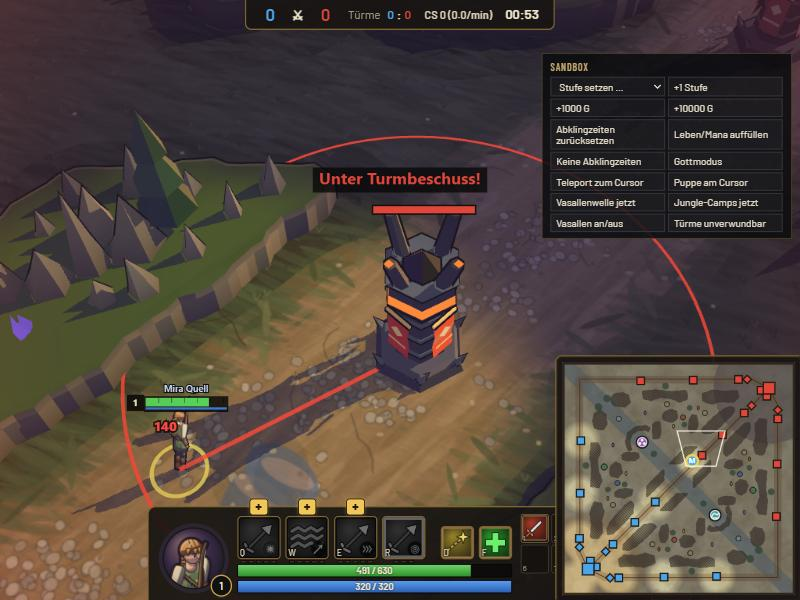

- **Gut:** Reichweitenkreis erscheint beim Annähern, rot + Ziellinie wenn der Turm dich anvisiert,
  „Unter Turmbeschuss!“-Hinweis, Schadenszahl.
- **Schwach:** Turm-Schuss selbst ist optisch schwach (kein dicker Energie-Strahl wie in LoL).

## 8. Tod
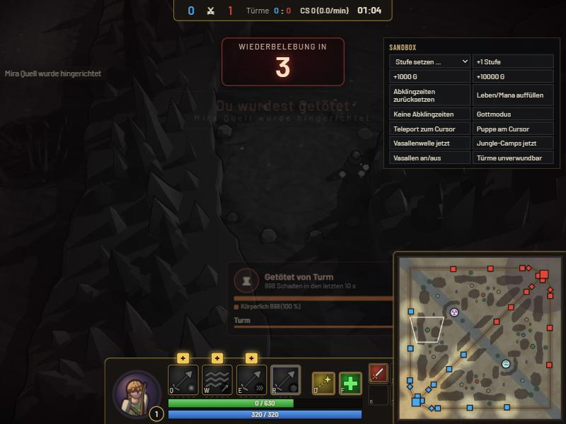

- **Gut:** großer Respawn-Timer, „Getötet von …“ mit Schadensaufteilung, Graustufen, Ansage.
- **Schwach:** Kamera zeigt danach nur Nebel/dunkle Fläche; kein Hinweis „Kamera frei bewegen“.

## 9. Jungle-Camp
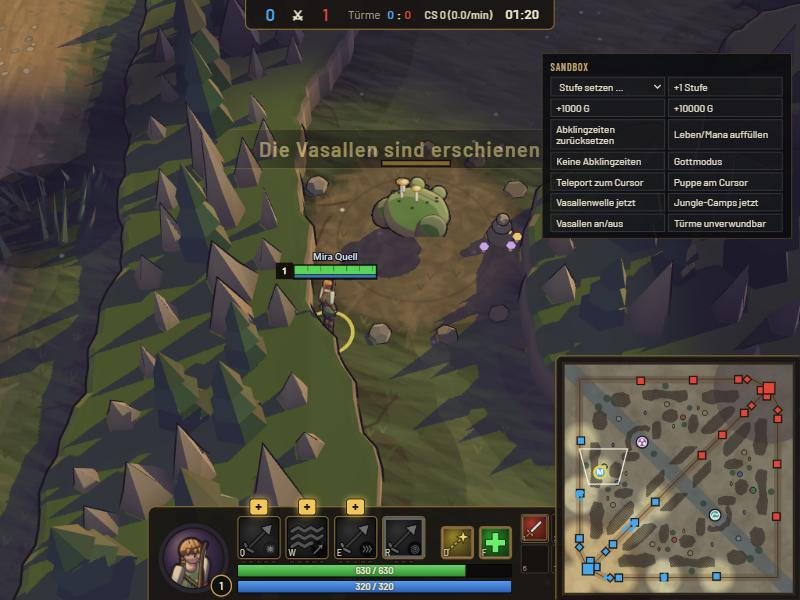

- **Gut:** Lichtung mit Steinen, Pilzen, gemaltes Monster (Sumpfunke), Inhalt wie LoL (6 Lager, Kesselbrut, Pflanzen).
- **Schwach (Nutzer-Kritik bestätigt):** Camps und Monster **viel zu klein**, Lichtung wirkt wie ein Erdfleck,
  Klippen daneben riesig. Buffs nicht imposant genug. → Agent „Maßstab & Camps“ arbeitet daran.

## 10. Shop
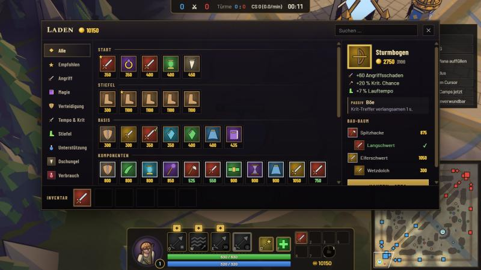

- **Gut (neu):** Kategorien mit Icons, Suche, große Kacheln mit Stern (empfohlen) und Haken (besitzt),
  Detailseite mit Werten, Passiv/Aktiv, **Bau-Baum mit abgehakten Teilen**, reduzierter Preis (2750 statt ~~3100~~),
  Kaufen-Knopf, Inventar mit Verkaufen.
- **Schwach:** bei kleinen Fenstern wenig Platz; kein „Rückgängig“; keine Gold-Effizienz-Anzeige.

## 11. Scoreboard
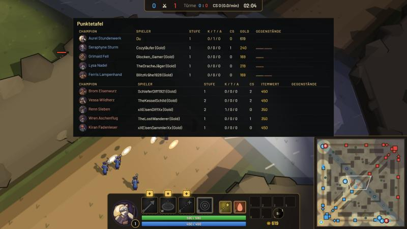

- **Gut:** beide Teams, K/D/A, CS, Gold/Item-Wert, Porträts, Item-Icons.
- **Schwach:** schlicht; keine Beschwörerzauber-Abklingzeiten der Gegner, keine Drachen-/Objective-Übersicht.

## 12. Enzyklopädie
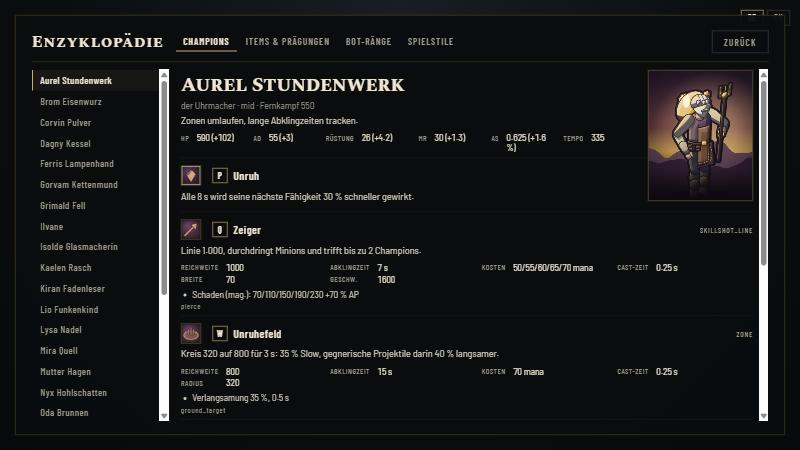

- **Gut:** Splash, Werte, alle Fähigkeiten mit Icons und Tooltips, Items und Prägungen mit Icons.

## 13. Champions im Spiel
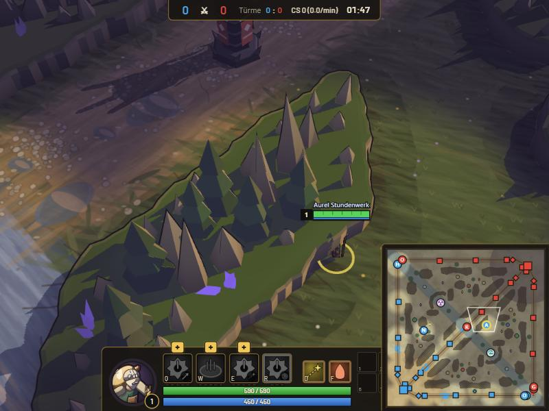

- **Befund:** Champion läuft eng an der Klippenkante entlang; Sprite überlappt optisch die Klippenoberseite.
  Champion wirkt im Verhältnis zu Bäumen/Klippen klein. → Maßstab-Agent.

## 14. Champion-Roster
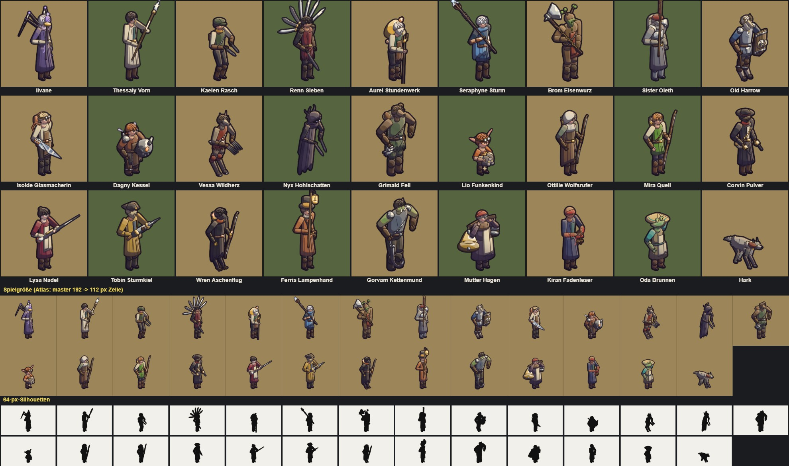

- **Gut (neu):** 12 Nicht-Menschen (Spinnen-, Baum-, Stein-, Widder-, Wolf-, Bären-, Raben-, Froschvolk, Zwerg,
  Geist, Oger, Yordle-artig), eigene Farben, klar unterscheidbare Silhouetten; Animationen auf den Trefferzeitpunkt
  synchronisiert (Ausholen → Schlag genau beim Schaden), Zauber nach Cast-Zeit.
- **Schwach:** im Spiel noch nicht ausgiebig angeschaut; Größe im Spiel eher klein.

---

## Mechanik (seit heute)
- Wind-ups LoL-artig (Schützen ~270 ms auf Stufe 1 statt 470 ms), Sound beim Abschuss.
- Weiche Kollision Champion ↔ Minion/Champion (Überlappung 3223 → 10 Ticks pro 4-min-Spiel).
- Gezielte Zauber laufen in Reichweite, Eingabe-Puffer ~0,25 s, Flash während Wind-ups (R-Flash).
- Zauber mit Anzeige (Taste halten → Reichweite + Form, loslassen → wirken).
- Auto-Angriff im Stand (nach Stopp aus).
- Flüssigere Bewegung (halber Tick Puffer), HP-Nachlauf-Balken, Treffer-Funken, Turmkreis.

## Bots
- Spielen alle Rollen, farmen, gehen Drache/Kesselbrut/Baron, warden, recallen, flamen und pingen.
- **Schwach:** zu passiv, Partien 40–45 min, CS ~50 % der Zielwerte, höherer Rang gewinnt nicht öfter,
  Wegfindung unsauber (Zickzack/Hängen) → Agent „Tempo/Balance + Wegfindung“ arbeitet daran.

## Was gerade läuft
- **Tempo/Balance + Bot-Wegfindung** (Agent)
- **Maßstab der Karte + Camps** (Agent)
- Lead: CC-Symbole, eigene Projektil-Optik, Zauber-Fehlermeldungen („Nicht genug Mana“), danach Szenario-Trainer
  und „Was ein Challenger getan hätte“.
